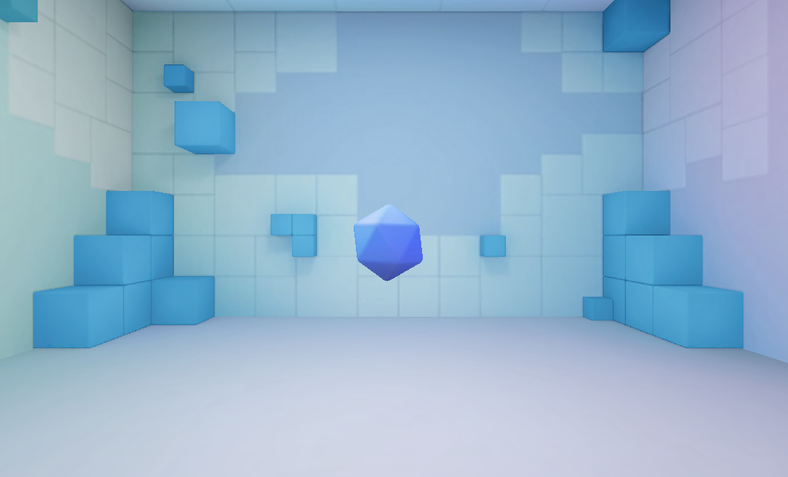
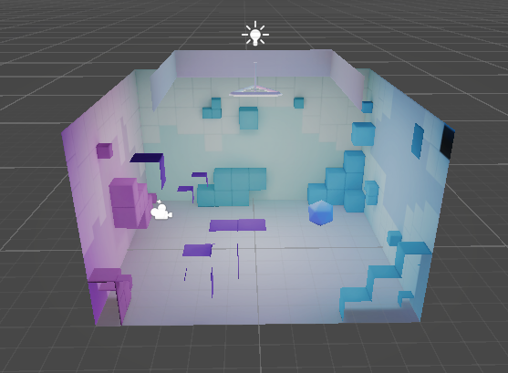
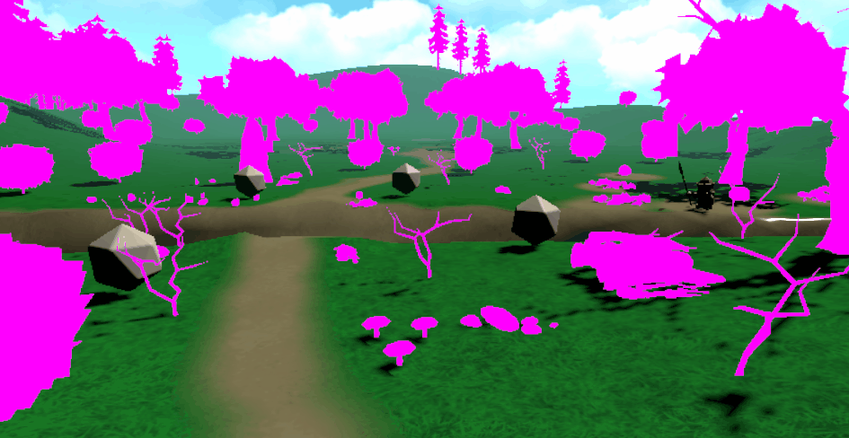

# Cardboards

## SDK and APK

### Software Development Kit (SDK)

A Software Development Kit (SDK) is a set of tools, libraries, and 
documentation provided to build applications for a specific platform. In 
virtual reality, the Google Cardboard XR Plugin for Unity serves as an SDK by 
linking the application with a smartphone's gyroscope and accelerometer.

[Quickstart for Google Cardboard for Unity](https://developers.google.com/cardboard/develop/unity/quickstart)

### Android Package (APK)

An Android Package (APK) is the standard file format for distributing, 
installing, and running applications on the Android operating system. It 
functions as an archive containing compiled code binaries, native libraries, 
scene geometry, textures, audio, and metadata.

## Application Build Process and Versioning Strategy

### Google Cardboard Integration and Initial Sample Build

The development process began by integrating the official Google Cardboard XR 
Plugin into Unity using the Package Manager. Following the standard integration 
guidelines provided in the official Google documentation, project settings 
were modified to target the Android platform. To verify platform compatibility 
and deployment pipelines, an initial baseline Android Package (APK) was 
generated using the default Google Cardboard sample scene. This default build 
is in `./apks/default.apk`.

### Custom Project Build according to Academic Requirements

Following the compilation and execution of the sample application, a second, 
fully customized APK was generated. This final build incorporated the custom 
environment, terrain assets, interactive elements, and custom C# scripts 
designed strictly in accordance with the specifications. The final APK is in 
`./apks/cardboard-scene.apk`.

## Scripts

### System Requirements

The specifications required creating an interactive mobile VR scene with 
look-directed navigation, trigger inputs, individual collectable focus 
interactions, and global item collection. The behavior was modularized into 
three C# scripts: `CollectableItem.cs`, `CollectableRetriever.cs`, and 
`PlayerCamera.cs`.

### CollectableItem.cs

`CollectableItem.cs` manages individual item lifecycles and look interactions 
by implementing `IPointerEnterHandler` and `IPointerExitHandler`. When the 
reticle aligns with an item, `OnPointerEnter` starts a coroutine that moves the 
object toward the player via `Vector3.MoveTowards`. If the user breaks look, 
`OnPointerExit` halts the coroutine to stop movement immediately. The script 
also exposes `AttractTowards` for external global attraction calls.

### CollectableRetriever.cs

`CollectableRetriever.cs` acts as a global trigger using 
`IPointerEnterHandler`. Upon pointer alignment, it queries active entities 
using `GameObject.FindGameObjectsWithTag("Collectable")`, loops through the 
array to retrieve each `CollectableItem` component, and invokes 
`AttractTowards` with the current camera position to attract all items 
simultaneously.

### PlayerCamera.cs

`PlayerCamera.cs` handles player locomotion. Its `Update` method evaluates 
three conditions to set a `shouldMove` boolean: downward head tilt past a pitch 
threshold, touch/pointer presses via Unity's Input System, or Google Cardboard 
trigger presses. When active, it extracts the camera's forward vector, zeroes 
the Y component to keep movement grounded, normalizes the vector, and 
translates the player over time.

### System testing

The implementation and runtime behaviors were tested and verified. A gif 
demonstration accompanies this report to record the execution and 
interactions within the scene:

## Other information

This code was developed by 
* [Cristhian Adoney Cruz Delgado](https://github.com/CristhianCruzDelgado)

Contact emails 
* <alu0101648293@ull.edu.es>

This code was designed for Intelligent Interfaces, \
signature of the Computer Engineering degree, \
that is studied at the Univeridad de La Laguna.

_5 November 2026_
